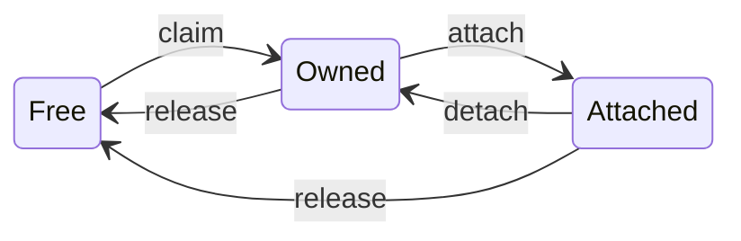

# Playwright Extension: Design

The extension lets Playwright clients (the library, the MCP server and the CLI) control tabs in the browser profile of the user. More than one client can be connected at the same time.

The design has one central rule: **each tab has zero owners or one owner, and one object, `TabRegistry`, is the only place that changes an owner.** Tab groups, the command checks and the events to the clients all follow from that table.

## Model

- **Client.** A Playwright process. It speaks CDP to the extension, as if the extension is a browser that has only the tabs of this client. In the extension, a connected client is a `ClientSession`.
- **Owned tab.** A tab that one session owns. Only the owner gets its events and can send it commands.
- **Free tab.** A tab with no owner. The user can give it to a client.
- **Reserved tab.** A connect page that waits for the user. It has no owner, and no client can claim it.
- **Client group.** The Chrome tab group of a session that has grouping. Its tabs are exactly the tabs that the session owns.
- **Free group.** Any tab group with no session, including the groups of the user. A client group becomes free, and gray, when its session closes.

Three rules are always true:

1. A tab has zero owners or one owner.
2. If a session has grouping, a tab is in its group if and only if the session owns it.
3. A session can send commands only to tabs that it owns, and no CDP command from the list of refused methods.
4. `ClientSession` is the only class that sends the commands of a client to Chrome, and it gets them as CDP. The checks of rule 3 are there, one time, for all protocol versions.

Clients are not isolated from each other for reading. A client can read browser-level data, for example the cookies of the full profile. A client cannot change browser-level state.

## Tab states



| Transition | Causes | Message to the client |
| --- | --- | --- |
| claim | Pick on the connect page. Drag into the group of the client. `Target.createTarget` from the client. Popup from an owned tab. Transfer from another client. | None. The extension attaches the debugger immediately. A tab with a URL that cannot be debugged (`chrome:`, `edge:`, `devtools:`) waits until it navigates. |
| attach | The extension attached the debugger to a tab of the client | `Target.attachedToTarget` with a new session id. For `Target.createTarget`, the event comes before the response. |
| detach | Chrome detached the debugger: the user closed the debug bar, or a frame loaded that extensions cannot debug | `Target.detachedFromTarget` |
| release | Drag out of the group. Transfer to another client. The session closed. | `Target.detachedFromTarget` |
| tab closed | The user or the client closed the tab | `Target.detachedFromTarget` |

The client gets these events only after it sent `Target.setAutoAttach` with no session, as with a browser.

Two details:

- **Second attach.** Chrome reports `target_closed` for a tab that stays open, for example when a frame goes to an unknown scheme. The client forgets the tab on each detach. Thus, 150 ms after such a detach, `OwnedTab` announces the tab to its session again, at most one time in 3 seconds for each tab, and the session attaches again.
- **Closed tab in a group.** When a grouped tab closes, Chrome first reports that the tab left its group. This is a release, and the client gets the same event as for a closed tab.

## Classes

Each Chrome API has one class that calls it: `chrome.debugger` belongs to `OwnedTab`, `chrome.tabGroups` belongs to `TabGroupManager`, and the WebSocket belongs to `Channel`.

| Class | File | How many | Responsibility |
| --- | --- | --- | --- |
| `Extension` | `background.ts` | 1 | Start point of the service worker. Makes the other objects. Answers the runtime messages of the two pages, after the start cleanup. |
| `ConnectionBroker` | `connectionBroker.ts` | 1 | The handshake. Records the URL of the client for each connect page and reserves its tab. After approval, opens the `Channel`, makes the `ClientSession` and gives the selection to `TabPicker`. Holds the sessions. Keeps the service worker alive and the Chrome listeners on while it has work. |
| `TabPicker` | `tabPicker.ts` | 1 | What a new client can take: free groups and free tabs. Applies a selection: one group, or some tabs, or the blank tab. |
| `TabRegistry` | `tabRegistry.ts` | 1 | The owner table: tab id to `OwnedTab`. The only place that changes an owner (`claim`, `release`, `transfer`, `releaseAll`). Holds the reserved tabs (`reserve`, `unreserve`). Sends the Chrome events of a tab to its `OwnedTab`. Gives a popup to the owner of its opener. |
| `OwnedTab` | `ownedTab.ts` | 1 per owned tab | The debugger of one tab: attach, detach, CDP commands, the ✓ badge, the announcement to the session. |
| `ClientSession` | `clientSession.ts` | 1 per client | The CDP protocol for one client. Makes a CDP target with a session id for each tab of the client. Answers the browser commands, checks each other command, then calls `OwnedTab` or `chrome.tabs`. Sends events only for its own tabs. |
| `ProtocolV2Channel` | `protocolV2.ts` | 1 per client of version 2 | Changes the `chrome.*` protocol of a version 2 client into CDP and back, see [Protocol version 2](#protocol-version-2). Calls no Chrome API. |
| `checkCdpMethod` | `cdpPolicy.ts` | | The list of CDP methods that a client cannot use |
| `Channel` | `channel.ts` | 1 per client | The WebSocket: JSON messages. Closes on a message that is not JSON. `ClientChannel` is its interface, which the session uses. |
| `TabGroupManager` | `tabGroupManager.ts` | 1 | Keeps group membership and ownership the same. Makes a group gray when its session closes. Finds free groups. |
| `ClientTabGroup` | `tabGroupManager.ts` | 1 per client with grouping | One Chrome group: its id, title and color. Makes the Chrome group when the first tab comes. |
| `ChromeListeners` | `chromeListeners.ts` | 1 | The listeners of all Chrome tab, tab group and debugger events. Adds and removes them together. |

The extension has two pages. The connect page (`ui/connect.tsx`) is for one client that asks to connect: it checks the request and shows the pick list. The manage page (`ui/manage.tsx`) is the landing page of the extension, and the extension icon in the toolbar opens it. It shows the connected clients and their tabs, and it lets the user disconnect a client or rotate the token.

### How `TabGroupManager` keeps groups and owners the same

It reacts to two events, and each one has one direction:

1. **A tab changed its group in Chrome**, because the user dragged it. The manager finds the owner that the tab must have now, and calls the registry if the owner is different.
   - The tab is in the group of session B: the owner must be B. This is a `transfer`.
   - The tab left the group of its owner: no owner. This is a `release`.
   - The owner has no grouping, and the tab is not in a client group: no change.
   - The tab is reserved: the manager moves it out of the group again.
2. **The registry claimed a tab for a session** (pick, new tab, popup, transfer). If the session has grouping and the tab is not in its group, the manager moves the tab in.

Each action causes the other event one time, and that event finds the same owner for the tab and for its group, so it does nothing.

All group changes go through one queue (`changeGroups`), which runs them one at a time. Thus two first tabs of a client do not make two groups, and the handler of event 1 waits for the queue before it compares the owners. Chrome refuses a group change while the user drags a tab, so the queue tries each change again for 1.5 seconds.

Chrome does not put the tab of a popup window into a group. Such a tab stays owned and outside the group.

## Protocol

The extension opens the WebSocket to the client, because an extension cannot listen on a port. After that, the WebSocket is a CDP transport with flat sessions, in protocol version 3:

- Command from the client: `{ id, method, params, sessionId? }`
- Response: `{ id, sessionId?, result }` or `{ id, sessionId?, error: { code?, message } }`
- Event to the client: `{ method, params, sessionId? }`

The client sees a browser that has only its own tabs. Each attached tab is a page target with a session id that the extension makes (`pw-tab-<n>`). The sessions of the workers and the frames of a tab have the ids that Chrome gives them.

The extension answers no command before the first tabs of the client are claimed. Thus the response to the first `Target.setAutoAttach` comes after a `Target.attachedToTarget` event for each of them, and no message is necessary for the end of the handshake.

### Commands that the extension answers

`ClientSession` answers these commands itself. They, and the `tabId` in the target info of `Target.attachedToTarget`, are the full difference from the CDP of a browser.

| Command | Answer |
| --- | --- |
| `Browser.getVersion` | A fixed product name, `Chrome/Extension-Bridge` |
| `Browser.setDownloadBehavior` | Empty result. The downloads of the user do not change. |
| `Target.setAutoAttach` with no session | Attaches the debugger to each tab of the client, now and later, and sends `Target.attachedToTarget` for each |
| `Target.createTarget` | `chrome.tabs.create` with `url`. The new tab belongs to the session. Only `url` is used. |
| `Target.closeTarget` | `chrome.tabs.remove` for a tab of the session. `{ success: false }` for another target. |
| `Page.bringToFront`, `Target.activateTarget` | Empty result for a client with `background`. If not, the command goes to Chrome. |

Each other command goes to `chrome.debugger.sendCommand`:

| Session id of the command | Tab |
| --- | --- |
| The session of a tab | That tab |
| The session of a worker or a frame | The tab that has it |
| None | The first attached tab of the client. This is for browser commands such as `Storage.getCookies`, for which the tab makes no difference. |
| Another value | Error: `No tab found for sessionId: <id>` |

A session id is known only while the client owns the tab, so a client cannot send a command to the tab of another client. A new command for the extension is a new row in the first table. It needs no change in the transport.

### Refused CDP methods

`checkCdpMethod` refuses the methods below, because they change the state of the browser and not of one tab. All other methods pass, including read methods such as `Storage.getCookies`.

| Refused | Effect in Playwright |
| --- | --- |
| `Storage.setCookies`, `Storage.clearCookies`, `Network.clearBrowserCookies`, `Network.clearBrowserCache` | `context.addCookies()` and `context.clearCookies()` fail |
| `Browser.grantPermissions`, `Browser.resetPermissions`, `Browser.setPermission` | `context.grantPermissions()` and `context.clearPermissions()` fail |
| `Target.attachToTarget`, `Target.activateTarget` | None |

The check is in `ClientSession`, after the commands that it answers itself. Thus `Target.createTarget` and `Target.closeTarget` are not in the list: the session changes them into tabs of the client.

### Protocol version 2

The clients that were released before version 3 have a relay in the client. The relay changes CDP into `chrome.*` commands, and it expects `chrome.*` events. For these clients, the connect page gives the version to the service worker, and `ConnectionBroker` puts a `ProtocolV2Channel` between the WebSocket and the session:

```
version 3 client ── CDP ───────────────────────── Channel ──────── CDP ─┐
                                                                        ├─ ClientSession ─ OwnedTab ─ Chrome
version 2 client ── chrome.* ── Channel ── ProtocolV2Channel ───── CDP ─┘
```

`ProtocolV2Channel` only changes one protocol into the other. It calls no Chrome API. It knows the tabs of its client only from the `Target.attachedToTarget` events of the session, so a tab id that it does not know is a tab that the client does not own. All other classes are the same for the two versions.

| Version 2 command | CDP to the session |
| --- | --- |
| `chrome.debugger.attach` | None. The session attached the debugger already. The target must have `tabId` and no `targetId` or `extensionId`, and the tab must be known. |
| `chrome.debugger.sendCommand` | The CDP command, with the session id of the tab, or with the session id of the worker or frame that the client gave |
| `chrome.tabs.create` | `Target.createTarget` with `url` |
| `chrome.tabs.remove` | `Target.closeTarget` for each tab. All tab ids must be known. |

| CDP from the session | Version 2 event |
| --- | --- |
| `Target.attachedToTarget` for a tab | `chrome.tabs.onCreated`. The client then sends `chrome.debugger.attach`. Not sent for a tab that the client made with `chrome.tabs.create`: the response announces it. |
| `Target.detachedFromTarget` for a tab | `chrome.debugger.onDetach` with the reason `target_closed` |
| An event with a session id | `chrome.debugger.onEvent` |
| The response to `Target.setAutoAttach`, which the layer sends at the start | `extension.initialized` |

`chrome.debugger.detach` was in version 2, but no released client sent it. It is not supported.

The versions change in this order:

1. The extension with versions 2 and 3 is released. Chrome updates it for the users. All released clients ask for version 2 and work as before.
2. Playwright with version 3 is released. It asks for version 3 only.
3. A version 3 client with an extension that is too old: the connect page asks the user to update the extension, and the client gets a timeout error.
4. When the version 2 clients are out of use, `protocolV2.ts` and this section are removed. The connect page then asks such a client to update.

### Connect page URL

The client starts the browser with `connect.html` and these parameters:

| Parameter | Value |
| --- | --- |
| `mcpRelayUrl` | The WebSocket URL of the client. The host must be loopback. |
| `protocolVersion` | The protocol version of the client: `3`, or `2` for a client with a relay |
| `client` | JSON with the name of the client |
| `token` | Optional. With the token of the extension, the connect page does not ask the user. |
| `tabGroup` | `false` for a client without grouping |
| `tabGroupTitle` | Optional title of the group. The default is `Playwright · <client name>`. |
| `tabGroupColor` | Optional color: `green`, `blue`, `purple`, `orange`, `pink`, `cyan`, `yellow` or `red`. The default is the first of these, in this order, that no other client group has. `grey` is refused, because it marks a group that its client left. |
| `background` | `true` if the tabs of the client must not become active |

The endpoint of `connectOverCDP` tells which browser profile to connect to: `extension://<channel>[/<profile directory>][?userDataDir=<path>&executablePath=<path>]`, for example `extension://chrome/Profile 1`.

| Part | Value |
| --- | --- |
| channel | The browser channel, for example `chrome` or `msedge` |
| profile directory | Optional. The default is `Default`. |
| `userDataDir` | Optional. The default is the user data directory of the channel. |
| `executablePath` | Optional. With it, the client does not check that the profile has the extension, because the browser can be in another file system, for example Windows Chrome from WSL2. |

The other values are the headers of `connectOverCDP`.

| Header | Value |
| --- | --- |
| `x-playwright-extension-client-name` | The name of the client. The default is `Playwright`. |
| `x-playwright-extension-token` | The token of the extension |
| `x-playwright-extension-tab-group` | `false` for a client without grouping |
| `x-playwright-extension-tab-group-title` | The title of the group |
| `x-playwright-extension-tab-group-color` | The color of the group |
| `x-playwright-extension-background` | `true` if the tabs of the client must not become active |

The MCP server has the options `--session-name`, `--session-color`, `--no-tab-group` and `--background`. The session name is the title of the group, and the session color is its color. The CLI gives the name of its session as the title, and `attach` has the options `--session-color` and `--no-tab-group`. `detach --close-tabs` closes each page of the session with `Target.closeTarget` before the client stops, so the session leaves no gray group.

### Runtime messages

The pages send these messages to the service worker. They are internal to the extension.

| Message | From | What it does |
| --- | --- | --- |
| `connectionRequested { mcpRelayUrl }` | Connect page | `ConnectionBroker` records the URL of the client for this tab, and `TabRegistry` reserves the tab |
| `getCandidates` | Connect page | `TabPicker` gives the free groups and the free tabs |
| `connect { options, selection }` | Connect page | Opens the channel, makes the session for the protocol version in `options`, applies the selection. `selection` is `{ groupId }`, `{ tabIds }` or empty. |
| `keepalive` | Connect page | Keeps the service worker alive while the page waits for the user |
| `getStatus` | Manage page | Gives each session: id, client name, tab ids |
| `disconnect { sessionId }` | Manage page | Closes that session |

## Flows

### Connect

1. The client listens on a loopback port and starts the browser with the connect page URL. The page checks the host and the protocol version, then sends `connectionRequested`.
2. With a correct token, the page sends `connect` with an empty selection. With no token, the page shows the free groups and the free tabs. The user picks one group, or checks some tabs, or picks nothing, and clicks **Allow**. A pick in one list clears the other.
3. `ConnectionBroker` opens the `Channel` (5 second limit) and makes the `ClientSession`. `TabGroupManager` gives the session its color.
4. `TabPicker` applies the selection:
   - **One group.** A client with grouping takes the group: it gets the color of the client, and the title only if the client gave one. The registry claims the tabs of the group. For a client without grouping, the group does not change.
   - **Some tabs.** The registry claims each tab. For a client with grouping, the manager moves them into its group.
   - **Nothing.** The connect page goes to `about:blank`, and the registry claims it.
5. The first tab becomes active, unless `background` is set. The connect page closes, unless it became the blank tab.
6. The session starts to answer commands. Playwright uses the WebSocket as the transport of `connectOverCDP`, and sends `Target.setAutoAttach`.
7. The session attaches the debugger to each claimed tab and sends `Target.attachedToTarget` for each.

A group or a tab that another client took in the meantime gives an error on the connect page, and the session closes.

### Drag a tab from the group of client A to the group of client B

1. Chrome reports the new group of the tab.
2. `TabGroupManager` finds that the owner must be B and is A. It calls `TabRegistry.transfer(tab, B)`.
3. The registry releases the tab from A: the debugger detaches, and A gets `Target.detachedFromTarget`. Thus B does not get the CDP state of A.
4. The registry claims the tab for B. The session of B attaches the debugger, and B gets `Target.attachedToTarget`.

Playwright in A sees a closed page, and Playwright in B sees a new page. Other drags are parts of this flow:

| Drag | Registry call | The client sees |
| --- | --- | --- |
| Out of the group of A, to no group or to a free group | `release` | A: `Target.detachedFromTarget` |
| Free tab into the group of B | `transfer` | B: `Target.attachedToTarget` |
| Tab of a client without grouping into the group of B | `transfer` | Old owner: `Target.detachedFromTarget`. B: `Target.attachedToTarget`. |

A tab that the user drags into a free group goes to the client that takes that group later.

### Disconnect and resume

1. The channel closes: the client stopped, or the user clicked Disconnect on the manage page.
2. The registry releases all tabs of the session. Each `OwnedTab` detaches and clears its badge. The tabs stay open and are free.
3. `TabGroupManager` makes the group gray. The title and the tabs do not change.
4. Later, a client connects, and the user picks the gray group. The group gets the color of the new client, and the client gets `Target.attachedToTarget` for each of its tabs.

Resume is a pick of the user. A free group has no link to the client that left it, and any client can take it. A client that connects with a token gets no pick, so it starts with a blank tab and a new group.

A session with no tabs stays open. The client opens a blank tab with `Target.createTarget` on its next tool call.

A client without grouping leaves no group. Its tabs become free and stay where they are.

## Service worker

The sessions, the owner table and the pending connect pages are in the memory of the service worker. Chrome stops an idle service worker after 30 seconds. Two timers prevent that:

- While one or more sessions are open, `ConnectionBroker` calls an extension API each 20 seconds.
- While a connect page waits for the user, the page sends `keepalive` each 20 seconds.

Chrome starts a stopped service worker for each event that has a listener. Thus the listeners for tab, tab group and debugger events are on only while a session is open or a connect page waits. With no client, the browsing of the user does not start the service worker. A runtime message from one of the two pages starts it.

If the service worker stops in spite of the timers, its sessions close, and the clients connect again on their next tool call. A new service worker has no sessions, so it cleans up what the previous one left, before it answers a message:

- `TabGroupManager` records the ids of the client groups in `chrome.storage.session`. The new worker makes each recorded group gray.
- The new worker detaches the debuggers that the previous worker left attached, and clears their badges. The debugger of another tool stays attached.

The cleanup runs when the new worker starts, which is at the next runtime message. Until then, the group keeps the color of its client.

Gray groups stay after a browser restart.

## Client side

The client code is one file, `packages/playwright-core/src/server/chromium/crExtensionTransport.ts`. `connectOverCDP('extension://chrome')` calls `connectToExtension`, which does three things:

1. It checks that the profile has the extension.
2. It listens on a loopback port and starts the browser with the connect page URL.
3. It waits for the WebSocket of the extension and gives it to Playwright as an `ExtensionTransport`.

`ExtensionTransport` is a `ConnectionTransport`, the same interface as the WebSocket of a browser with remote debugging. It does not read or change the messages. The server stops when the transport closes.

The MCP server and the CLI use the same call (`tools/mcp/extensionContextFactory.ts`): they make the URL from their options or take it from `--cdp-endpoint` (MCP) and `attach --cdp` (CLI), read `PLAYWRIGHT_MCP_EXTENSION_TOKEN`, and pass the other options as headers.

## Tests

The tests are in `tests/extension`. `harness.ts` has two actors: `user`, the person at the browser, and the clients that `connect()` and `connectWithToken()` start. `connectCDP()` connects as a client, to send CDP commands directly. `connectRelay()` does the same for protocol version 2.

| File | Subject |
| --- | --- |
| `extension.spec.ts` | Connect page, token, protocol versions, browser profile, `connectOverCDP` |
| `client-lifecycle.spec.ts` | Clients that connect, leave, and take the tabs and groups of other clients |
| `tab-grouping.spec.ts` | Group title and color, gray groups, clients without grouping |
| `tab-dragging.spec.ts` | Drags between clients, free groups, new groups and windows |
| `tab-management.spec.ts` | Tabs that the client opens, selects and closes; popups |
| `protocol.spec.ts` | CDP targets, commands and events of a client. Events, owner checks and refused CDP methods of protocol version 2. |
| `scheme-detach.spec.ts` | Debugger detach by Chrome |
| `cli.spec.ts` | `attach --extension` from the CLI |
